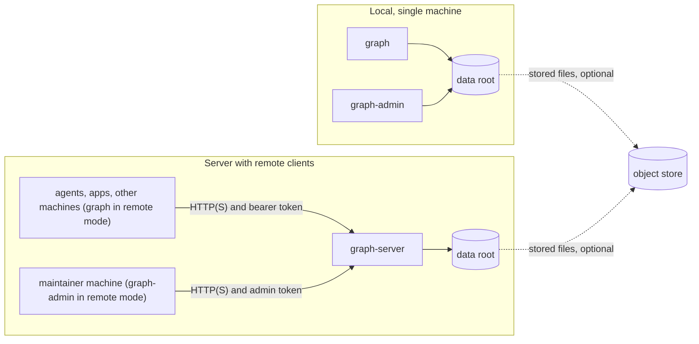
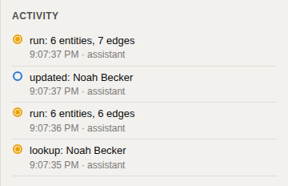

# Deployment options

graph_cli keeps the data of its graphs in one place, the data root, on one
machine. There are two ways to use it: work on that machine directly, or run
`graph-server` there and let everything else connect over HTTP. The server can
run as a plain process or in a container. Stored files (scans, documents) can
stay in the data root or live in an S3-compatible object store. This page
explains the options and links to the documents that hold the details.



The data root always holds the graph data and the audit trail. Only the bytes
of stored files can live in the object store.

## Local, single machine

`graph` is installed as a uv tool and `graph-admin` runs from the repository
checkout. Both read and write the data root directly. Programs on the same
machine can use it at the same time; writers to one graph wait for each other.

- **Choose it when** one person or one machine uses the graphs, agents included.
- **You need** uv, the checkout and a local POSIX file system for the data
  root.
- **Data root:** `graph-admin init` creates it, together with a `config.toml`.
  Where it lives and how to change that:
  [Locations](configuration.md#locations).
- **Access control** is a guardrail here, not a boundary: an agent with a shell
  can edit the files ([Security model](security_model.md)).
- **Exact install and first steps:** [Install](../README.md#install) and
  [Quickstart](../README.md#quickstart) in the README.

## Server with remote clients

`graph-server` owns the data root and answers the commands of `graph` over HTTP.
Every request carries a bearer token, and the installed policies decide what
the token may do. `graph` in remote mode keeps no data on its machine, so agents
in containers, other machines and web apps all reach the same graphs. Because
callers cannot touch the files, the policies are enforced, not only advised
([Prevention](security_model.md#prevention)).

```sh
graph-server serve                          # on the machine that holds the data
graph connect <endpoint> --code <code>      # on a client machine
graph-admin workspace sync <dir>            # on a maintainer machine
```

- **Choose it when** more than one machine, container or app needs the same
  graph, or when callers must not be able to edit the data.
- **You need** a machine that holds the data and runs the server, and one token
  per client ([Tokens and access](server.md#tokens-and-access)).
- **Enrollment:** instead of handing out a token, a maintainer hands out a
  one-time code. `graph connect` exchanges it for a token, sets up remote mode
  and installs `graph` and the graph skills
  ([Enrollment](server.md#enrollment)).
- **Client install and updates:** the server hands out the wheels of `graph`
  under `<endpoint>/v1/dist/`, and `graph self update` keeps a client in step
  with the server. A client of an incompatible build is refused
  ([Self update](server.md#self-update), [Builds](server.md#builds)).
- **Maintaining from another machine:** with the admin API switched on (off by
  default), `graph-admin` in remote mode maintains graphs from a maintainer
  machine, with an admin token. Creating the data root and the live view stay
  on the machine that holds the data
  ([Remote mode of `graph-admin`](server.md#remote-mode-of-graph-admin)).
- **Maintainer workspaces:** `graph-admin workspace sync` sets up a folder with
  the admin skills and one folder per graph, locally or in remote mode
  ([Maintainer workspaces](cli_graph_admin.md#maintainer-workspaces)).
- **Transport:** the server speaks plain HTTP and listens on the local machine
  only. Beyond that machine, put a TLS proxy in front
  ([Running it](server.md#running-it)). A proxy's read timeout matters for long
  releases ([Timeouts](server.md#timeouts)).
- **Client side:** [Remote mode](configuration.md#remote-mode) and
  [Remote mode of `graph`](server.md#remote-mode-of-graph).

## Container

The repository's `Dockerfile` builds an image with `graph`, `graph-admin` and
`graph-server`. `compose.yaml` runs the server in it, with the data in named
volumes.

```sh
docker compose up -d
```

- **Choose it when** the server runs on a host with Docker and you want no
  Python setup there.
- **What you get:** the server, reachable from the local machine only. The
  first start creates the data root and installs a default policy. Maintenance
  runs with `docker compose exec graph graph-admin ...`. A folder of authored
  ontologies and policies is mounted read only.
- **Public access:** an optional `tls` profile adds a reverse proxy with an
  automatic certificate for a public name.
- **The image** is published for each release and carries the wheels that
  clients install from the server
  ([CI and releases](../CONTRIBUTING.md#ci-and-releases)).
- **Details:** volumes, ports, moving an existing data root in and the object
  store in a container are in [Container](server.md#container).

## Stored files: data root or object store

By default the bytes of stored files sit in the data root, next to the graph.
Alternatively an S3-compatible object store holds them, graph by graph.

- **Choose the data root** when you want one place to run and back up. It is
  the default (`[files] store = "local"`).
- **Choose the object store** when the file bytes should not be on the data
  root's disk (`[files] store = "s3"`). The bucket and endpoint go into
  `[files.s3]`; the credentials come only from the environment, never from the
  config file ([Object storage](configuration.md#object-storage)).
- **What stays in the data root:** graph data, the audit trail, manifests,
  tokens and policies, also for a graph whose files are in the store
  ([Object storage](files.md#object-storage-optional)).
- **Who needs the settings:** every program that touches stored files
  (`graph` in local mode, `graph-server`, `graph-admin`, the live view). A
  `graph` in remote mode needs none.
- **Check and move:** `graph-admin files store check` tests the store.
  `graph-admin files move <graph> --to s3` (or `--to local`) moves an existing
  graph's files while writes go on
  ([Moving stored files](cli_graph_admin.md#moving-stored-files)). Changing the
  setting alone never moves a graph.
- **Trade-offs:** operations on stored files depend on the store being
  reachable, and older program versions cannot open such a graph
  ([Where stored files live](files.md#where-stored-files-live)). In a
  container: [Stored files in an object store](server.md#stored-files-in-an-object-store).

## Limitations

- **Local POSIX file systems only.** The data root must be on a local file
  system; network and shared file systems are not supported
  ([Storage](storage.md#filestore), [Locations](configuration.md#locations)).
- **One owner machine per data root.** Other machines do not open the data root;
  they use `graph-server` and `graph` in remote mode.
- **The server needs its own data root.** `graph-server` refuses to start when
  its configuration says remote mode ([Running it](server.md#running-it)).
- **Only file bytes can live elsewhere**, and only in an S3-compatible object
  store.

## Backups

What to back up depends on the option. The procedures are in the linked
documents.

| Option | Back up |
| --- | --- |
| Local, single machine | the data root, and `config.toml` if you changed it |
| Server (plain process) | the data root of the server machine |
| Container | the data volume, and the configuration volume with the settings the server reads |
| Object store for files | the data root first, then the bucket |
| Remote clients | nothing: they hold no data, and their file cache can be deleted at any time ([File cache](files.md#file-cache)) |

After a restore, verify the audit trail and the stored files
([Backups](files.md#backups)). Backups of the data root can contain personal
data ([Data in backups](security_model.md#data-in-backups-and-audit-events)).

## Live view

`graph-admin view` serves an optional browser page. It shows a graph and its
recent activity, plus its types, model, functions and policies. Nobody needs it
to use graphs.

- It runs where the data lives, not in remote mode. It listens on the local
  machine only, and the printed address carries a secret token
  ([Access](live_view.md#access)).
- In the container it runs next to the server, with its port published to the
  local machine ([Container](server.md#container)).
- To show it to other machines, put an authenticating reverse proxy in front
  ([Behind a reverse proxy](live_view.md#behind-a-reverse-proxy)).

<!-- screenshot: live_view_activity -->


## Choosing an option

| Situation | Option |
| --- | --- |
| One person, one machine, agents on the same machine | [Local, single machine](#local-single-machine) |
| Agents in containers or on other machines need the same graph | [Server with remote clients](#server-with-remote-clients) |
| A web app reads or writes graphs | [Server with remote clients](#server-with-remote-clients) |
| Callers must not be able to edit data, policies or the audit trail | [Server with remote clients](#server-with-remote-clients) |
| The server host has Docker and no Python setup is wanted | [Container](#container) |
| Graphs are maintained from a machine that does not hold the data | [Server with remote clients](#server-with-remote-clients), admin API on |
| The file bytes should not be on the data root's disk | [Object store](#stored-files-data-root-or-object-store) |
| You want to look at a graph in a browser | [Live view](#live-view) |
| The data is on a network share, or several machines would write it directly | not supported: run the server where the data lives |

A local setup can grow into a server later: the data root moves into a container
as described in [Container](server.md#container).
