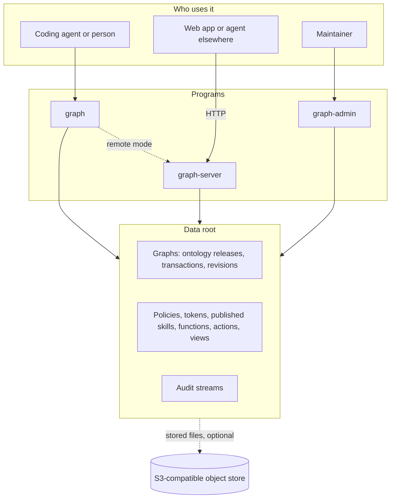
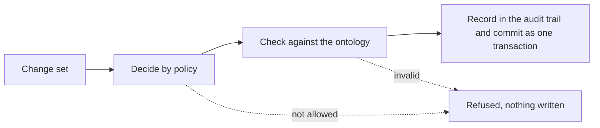

# Overview

This page explains in plain terms what graph_cli is, what it can be used
for and how its parts fit together. It is the starting point for people and
agents who want the big picture before the details. The other documents
hold the details; this page links to them.

## What graph_cli is

graph_cli keeps **typed knowledge graphs**: collections of entities (a
person, a system, a document, a decision ...) and the relations between
them, whose shape is fixed by a schema, the **ontology**. graph_cli itself
knows no domain: what a graph holds is decided entirely by its ontology.

It is built for two kinds of users at once:

- **Coding agents**, which read and write a graph through a command-line
  tool and get generated instructions (skills) that tell them how.
- **People**, who use the same commands, maintain the graphs and watch
  them in the browser.

Every change is checked against the ontology, allowed or refused by a
policy and recorded in an audit trail that can be verified later. Nothing
is overwritten: earlier states of the graph stay readable.

## What it can be used for

graph_cli is domain-agnostic. Some examples of what a graph can hold:

- **Shared memory for agents and people in a project**: facts about
  systems, components, people and decisions that several agents read and
  extend over time, with a record of who changed what and why.
- **A curated knowledge base**: entities with lifecycles (draft, active,
  retired ...), sources and history, where maintainers decide which kinds of
  facts exist and agents fill them in.
- **A mirror of an external source**: a pipeline hands graph_cli the
  desired state of what it collected, and graph_cli works out what to
  create, update and retire ([Reconciling a source](cli_graph.md#reconciling-a-source)).
- **A collection of files with metadata**: scans, documents and other
  files stored by content, with the metadata the files declare about
  themselves and the entities they belong to ([Files](files.md)).
- **A backend for other programs**: web apps and agents on other machines
  use the same commands over HTTP ([Server](server.md)).

What graph_cli does not do:

- It does not read what is *in* a file (text, meaning); an agent does that
  and records what it finds.
- It holds no connectors or credentials for external sources; a pipeline
  that mirrors a source keeps those itself.
- Its query language is a read-only subset of Cypher, sized for questions
  agents and people ask, not for large analytical workloads
  ([Cypher queries](cli_graph.md#cypher-queries)).
- Its data lives on local POSIX file systems of one machine; other machines
  reach it through the server ([Deployment options](deployment_options.md)).

## Core concepts

| Concept | In short |
| --- | --- |
| Data root | the directory on one machine that holds all graphs, policies and audit streams of an installation |
| Graph | one knowledge graph in the data root, pinned to one version of its ontology |
| Ontology | the schema of a graph: classes, attributes, relations, enums, lifecycles and rules, written as YAML and released in versions ([ontology authoring](../packages/graph_cli_admin/src/graph_cli_admin/bundled_skills/ontology-best-practices/SKILL.md)) |
| Entity | one thing in a graph, with an id, a type from the ontology, attributes and revisions |
| Relation (edge) | a typed link between two entities |
| Change set | one validated write: one or more operations applied together or not at all |
| Lifecycle | the states an entity of a type can be in and the allowed transitions between them |
| Audit trail | the chained record of every change and maintenance step, checked by `graph-admin audit verify` ([Audit](audit.md)) |
| Policy | the rules that decide who may read or write what, per caller, project and graph ([Access control](access_control.md)) |
| Project pointer | a small file in a project directory that names the graphs the project uses ([Configuration](configuration.md#project-pointer)) |
| Skill | generated instructions for coding agents: one for the CLI, one per graph ([Skills](skills.md)) |
| Function, action, view | named, reviewed reads, writes and compositions of reads that a maintainer publishes for recurring questions and changes ([Functions](cli_graph.md#functions), [Actions](cli_graph.md#actions), [Views](cli_graph.md#authored-views-and-set-views)) |

## How the parts fit together

graph_cli consists of three programs over one data root:

- `graph` reads and writes the data of existing graphs. It is what agents
  and people use day to day ([`graph`](cli_graph.md)).
- `graph-admin` maintains: it creates graphs, releases ontology versions,
  installs policies, publishes skills, functions, actions and views,
  verifies the audit trail and serves the live view
  ([`graph-admin`](cli_graph_admin.md)).
- `graph-server` offers the commands of `graph` (and, when switched on, those
  of `graph-admin`) over HTTP, so that agents in containers, other machines and
  web apps can use a graph ([Server](server.md)).

Every write takes the same path, whichever program or interface it comes
from:

The details of the write path are in [Architecture](architecture.md).

## A typical lifecycle

1. A maintainer writes an ontology, checks it with `graph-admin ontology
   validate` and creates a graph from it with `graph-admin graph create`.
2. The maintainer publishes a graph skill and, where useful, functions,
   actions and views, and installs a policy.
3. A project names the graph in its project pointer. An agent calls `graph
   start` once per session, which installs or refreshes its skills, and then
   reads and writes with `graph`.
4. When the model needs to change, the maintainer releases a new ontology
   version; a migration moves existing data where the change requires it.
5. `graph-admin audit verify` checks at any time that the recorded history
   is complete and unchanged.

Maintainers usually work from a maintainer workspace, a folder with one
subfolder per graph and the admin skills for their agents
([Maintainer workspaces](cli_graph_admin.md#maintainer-workspaces)).

## What it looks like

Every `graph` command answers with one envelope, as compact text or, with
`--json`, as one JSON document ([Output and exit codes](cli_graph.md#output-and-exit-codes)).
The live view shows the graphs of a data root in the browser
([Live view](live_view.md)).

<!-- screenshot: live_view_graph -->
> **Screenshot placeholder:** the live view of the example graph, with the
> graph drawn as dots and lines and the list of recent activity.

<!-- screenshot: live_view_model -->
> **Screenshot placeholder:** the live view showing the types of a graph as
> a graph, next to its ontology and functions.

<!-- screenshot: terminal_session -->
> **Screenshot placeholder:** a terminal session in which an agent starts a
> session with `graph start`, looks up an entity and records a new fact.

## Where to go next

- Try it: [Install](../README.md#install) and
  [Quickstart](../README.md#quickstart), or the
  [example graph](../examples/company/README.md).
- Choose how to run it: [Deployment options](deployment_options.md).
- Understand why it is built this way: [Design decisions](design_decisions.md).
- All documents: [the documentation index](README.md).
